# 📊 Painel de Controle BSD - V-JP Harness

> [!NOTE]
> Este painel é atualizado dinamicamente pelo orquestrador BSD no final de cada transação de agente.

## 🚀 Status da Execução Atual

| Módulo/Feature | Task Ativa | Status | Progresso |
| :--- | :--- | :--- | :--- |
| **teste-fluxo** | `Concluído` | **SUCCESS** | `[▓▓▓▓▓▓▓▓▓▓▓▓▓▓▓▓▓▓▓▓] 100%` |

## 🧬 Pipeline Transacional por Task

```mermaid
flowchart TD
    Start["Task lida do tasks.md"] --> CreateWorktree["Criar Git Worktree Isolada"]
    CreateWorktree --> Planner["Agent: PLANNER (Análise de Risco)"]
    Planner --> Researcher["Agent: RESEARCHER (Mapeamento de Impacto)"]
    Researcher --> Executor["Agent: EXECUTOR (Escrita de Código & Testes)"]
    Executor --> Reviewer["Agent: REVIEWER (Validação via MCPs)"]
    
    Reviewer --> Condition{"Passou em 100% dos testes?"}
    Condition -- "Sim" --> MergeWorktree["Merge na Branch Principal & Limpeza"]
    Condition -- "Não" --> RetryCondition{"Tentativas < 2?"}
    
    RetryCondition -- "Sim" --> Executor
    RetryCondition -- "Não" --> Terminate["Abortar Task & Notificar Humano (STATE.md)"]
    
    MergeWorktree --> Next["Próxima Task"]

    style CreateWorktree fill:#1f2937,stroke:#3b82f6,stroke-width:2px
    style MergeWorktree fill:#1e1b4b,stroke:#a855f7,stroke-width:2px
```

---

## 🕒 Histórico de Transações Recentes
Para auditoria detalhada de auditoria à prova de crash, consulte [history.jsonl](file:///Users/jpdev/.local/share/vjp-harness-v1.10.0/.bsd/history.jsonl).

*Última atualização: 28/06/2026, 21:15:46*
