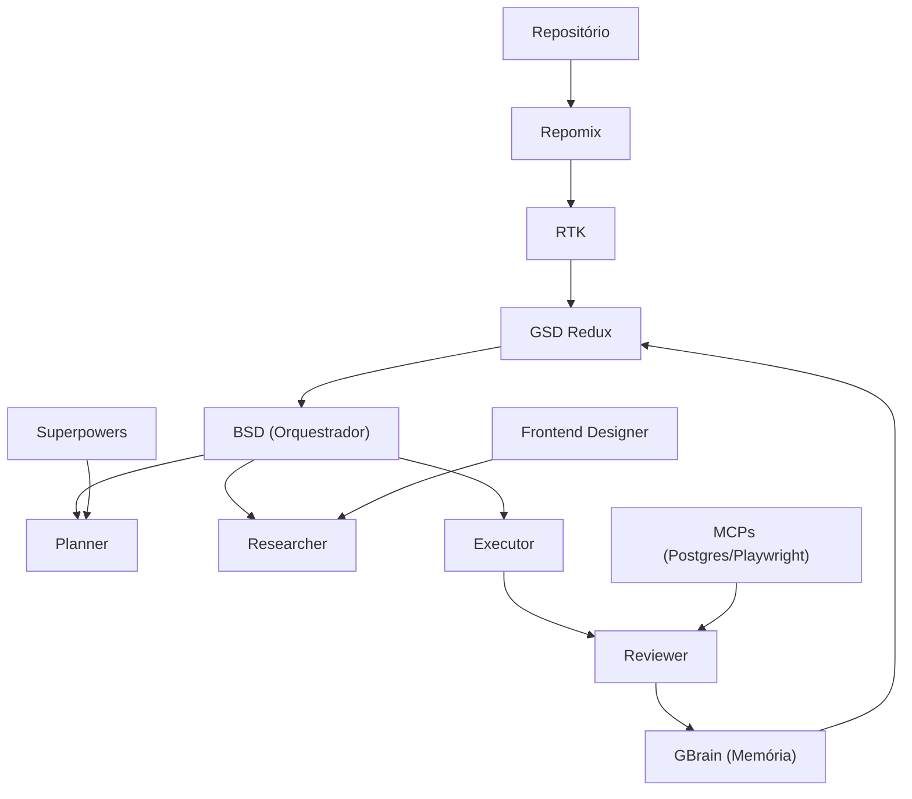

# V-JP Harness

Ecossistema de engenharia de software orientado a IA — empacotado para instalação **determinística** em qualquer projeto.

Combina compressão de contexto, memória persistente, planejamento spec-driven, execução autônoma, revisão automática e especialização por agentes — transformando a IA de gerador de código em um sistema que **planeja, pesquisa, implementa, revisa, aprende e evolui**.

---

## Arquitetura



O **GStack** é a camada operacional que conecta RTK, GBrain, GSD Redux e BSD numa arquitetura coesa e reutilizável.

---

## Instalação determinística

```bash
git clone https://github.com/Joao-Pedro-AI-Visionary/vjp-harness.git
cd meu-projeto
bash /caminho/para/vjp-harness/install.sh --name meu-projeto
```

O instalador é **idempotente** e usa `npm ci` (lockfile) para o núcleo. Detalhes completos em [`template/INSTALL.md`](./template/INSTALL.md).

| Flag | Efeito |
|---|---|
| `--target <dir>` | Projeto-alvo (default: diretório atual) |
| `--name <nome>` | Nome do projeto em `harness.yaml` |
| `--no-install` | Copia sem rodar `npm ci` |
| `--force` | Sobrescreve `.harness/` existente |
| `--yes` / `-y` | Não-interativo (CI) |

**Pré-requisitos:** Node ≥ 18; `git` opcional (habilita worktrees isoladas).

---

## Determinismo (o núcleo do projeto)

Toda dependência é **pinada** e **verificável**. A fonte da verdade é
[`template/registry.json`](./template/registry.json) (espelhada em
[`REGISTRY.md`](./template/REGISTRY.md)), consumida pelo verificador:

```bash
node .harness/tools/bsd.js --doctor            # checa cada componente vs versão pinada
node .harness/tools/bsd.js --doctor --strict   # falha também em opcionais ausentes
node .harness/tools/verify.js --json           # saída para CI (exit 1 se obrigatório falhar)
node .harness/tools/bsd.js --vendor            # clona componentes git pinados (assert de commit)
node .harness/tools/bsd.js --vendor --only superpowers   # vendoriza um só
```

### Vendorização determinística

O `install.sh` clona os componentes git **pinados no commit** para dentro de `.harness/tools/`:

| Componente | Repo | Ref | Destino |
|---|---|---|---|
| RTK | `rtk-ai/rtk` | `v0.39.0` @ `2fbc7514f696` | `.harness/tools/rtk/` |
| GBrain | `garrytan/gbrain` | `eval-run-v0.35.1.0-baseline` @ `3933eb6a7915` | `.harness/tools/gbrain/` |
| Superpowers | `obra/superpowers` | `v5.1.0` @ `f2cbfbefebbf` | `.harness/tools/superpowers/` |

`vendor.js` faz shallow clone na tag e **asserta o commit** (`startsWith`) — se a tag se mover, reporta DRIFT. Idempotente (pula se já no commit certo). Os clones entram no `.gitignore` do projeto (reproduzíveis pelo ref). Pule com `--no-vendor`.

### Componentes (pinados — Registro Definitivo)

| Componente | Repositório oficial | Versão |
|---|---|---|
| BSD | baseado em `garrytan/gstack` | `1.2.0` |
| RTK | `rtk-ai/rtk` | `0.39.0` |
| GBrain | `garrytan/gbrain` | `0.35.1.0` |
| Repomix | `yamadashy/repomix` (npm) | `0.2.14` |
| GSD Redux | `open-gsd/get-shit-done-redux` (npm) | `1.1.0` |
| Superpowers | `obra/superpowers` | `v5.1.0` |
| PostgreSQL MCP | `modelcontextprotocol/servers` | `0.6.2` |
| Playwright MCP | `modelcontextprotocol/servers` | `0.0.75` |
| Frontend Designer | `anthropics/skills` (`frontend-design`) | `main` |

> Núcleo obrigatório (BSD, Repomix, GSD Redux) é totalmente determinístico via
> `package-lock.json`. Opcionais são reportados pelo doctor sem bloquear.
> Matriz completa + notas de pinagem em [`template/REGISTRY.md`](./template/REGISTRY.md).

---

## Estrutura instalada no projeto

```
meu-projeto/
├── .harness/                 # MOTOR (versionável)
│   ├── harness.yaml              # manifesto: agentes, MCPs, tools pinadas
│   ├── registry.json             # ← fonte da verdade determinística
│   ├── REGISTRY.md  INSTALL.md   # matriz de instalação + guia
│   ├── AGENT_RULES.md            # regras dos 4 agentes
│   ├── tools/
│   │   ├── bsd.js                # orquestrador (--execute/--continue/--status/--reset/--doctor)
│   │   ├── verify.js             # verificador de determinismo
│   │   ├── package.json + lock   # tools pinadas (npm ci)
│   │   └── *.md                  # doc de cada componente
│   ├── config/{repomix,mcp}.json
│   └── context/                  # contexto compactado (regenerável)
├── .gbrain/                  # MEMÓRIA persistente (8 arquivos + PGLite)
└── .bsd/                     # ESTADO de execução (STATE.md, history.jsonl, worktrees/)
```

---

## Pipeline por task (BSD)

```
PLANNER → RESEARCHER → EXECUTOR → REVIEWER → APPROVED?
  └ Sim → próxima task        └ Não → retry em worktree (máx. 2) → aborta + STATE.md
```

```bash
node .harness/tools/bsd.js --execute <feature>
node .harness/tools/bsd.js --continue
node .harness/tools/bsd.js --status
node .harness/tools/bsd.js --reset
```

---

## Princípios

1. Contexto mínimo, informação máxima. 2. Planejar antes de implementar.
3. Pesquisar antes de modificar. 4. Revisar antes de aprovar.
5. Registrar decisões. 6. Aprender com erros. 7. Automatizar o repetitivo.
8. Agentes especializados. 9. Preservar histórico. 10. Evoluir o conhecimento.

---

## Agentes de IA (integração real)

Os 4 agentes rodam de verdade (`tools/agents.js` + `tools/llm.js`), **provider-agnostic**:
use **qualquer** provider — OpenAI, DeepSeek, Kimi, GLM, MiniMax, Groq, OpenRouter,
Together (todos via adapter `openai`), Anthropic ou Ollama local. Presets prontos +
override por ENV, sem fixar nada globalmente.

```bash
# 1. escolha o provider via ENV (sem editar arquivo) — troque quando quiser
export VJP_LLM_PRESET=deepseek            # ou kimi, glm, openrouter, ollama, cliproxy...
export VJP_LLM_MODEL=deepseek-chat
export VJP_LLM_API_KEY=sk-...             # ollama não precisa

# 2. valide a conectividade
node .harness/tools/bsd.js --check-llm

# 3. rode uma feature (EXECUTOR escreve+commita na worktree; merge se os testes passarem)
node .harness/tools/bsd.js --execute minha-feature

# (mecânica sem LLM, para testar o fluxo)
node .harness/tools/bsd.js --execute minha-feature --dry-run
```

> Fixar um modelo é **opcional** (só pra reproduzir um projeto) — não há provider
> default obrigatório. Presets em [`template/config/agents.json`](./template/config/agents.json).

Cada agente recebe `AGENT_RULES.md` + `.gbrain/*.md` como contexto e devolve JSON
estruturado. O EXECUTOR não recebe shell — só conteúdo de arquivos, aplicados na
git worktree isolada com proteção contra path traversal; o merge só acontece após
os testes verdes (`pipeline.testCommand`). Detalhes em [`template/tools/agents.md`](./template/tools/agents.md).

Versão: ver [`VERSION`](./VERSION).
