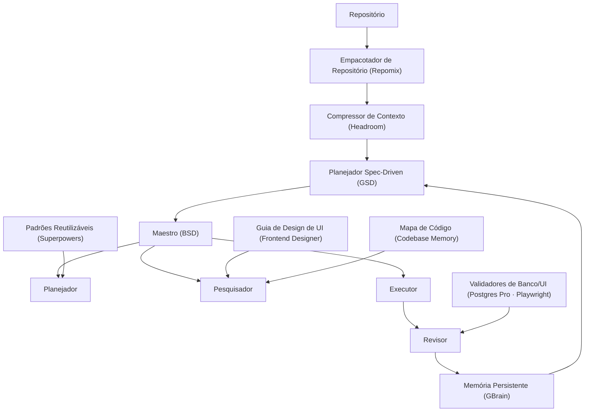

# V-JP Harness

> **Autor:** João Pedro (V-JP) · [github.com/Joao-Pedro-AI-Visionary](https://github.com/Joao-Pedro-AI-Visionary)
> **Versão:** 2.0.0 (fonte: [`VERSION`](./VERSION); histórico em [`CHANGELOG.md`](./CHANGELOG.md)) · Licença MIT · *método de engenharia de software orientado a IA*

Ecossistema de engenharia de software orientado a IA — empacotado para instalação **determinística** em qualquer projeto.

Combina compressão de contexto, memória persistente, planejamento spec-driven, execução autônoma, revisão automática e especialização por agentes — transformando a IA de gerador de código em um sistema que **planeja, pesquisa, implementa, revisa, aprende e evolui**.

> Este harness é o método de engenharia pessoal de **João Pedro (V-JP)**. Use, estude e adapte (MIT) — mantendo o crédito de autoria.

> **Nomes por papel:** desde a v1.9.0 cada peça é nomeada **pelo que faz**; o nome do projeto de origem fica entre parênteses como **procedência** (atribuição honesta + determinismo auditável). Ver a tabela de vocabulário abaixo.

---

## Arquitetura



O **Núcleo** (antes "GStack") é a camada operacional que conecta o Compressor de Contexto, a Memória Persistente, o Planejador Spec-Driven e o **Maestro** numa arquitetura coesa e reutilizável.

---

## 🗂️ Vocabulário — papel ↔ procedência

A superfície do harness fala por **papel**; o nome técnico é só a origem (crédito/licença MIT-Apache).

| Papel (o que faz) | Procedência | Seu? |
|---|---|:--:|
| **Maestro** — conduz o pipeline de 4 agentes | BSD (base `garrytan/gstack`) | 🟢 |
| **Núcleo** — a camada que amarra tudo | conceito V-JP (antes "GStack") | 🟢 |
| **Registro de Decisões** — grava ADRs no histórico | `tools/gbrain-decision.js` | 🟢 |
| **Compressor de Contexto** — mais sinal por janela | Headroom (proxy local, desde a v1.22.0) | 🔵 |
| **Empacotador de Repositório** — visão do todo | Repomix | 🔵 |
| **Memória Persistente** — estado entre sessões | GBrain | 🔵 |
| **Planejador Spec-Driven** — código nasce de spec | GSD Redux | 🔵 |
| **Padrões Reutilizáveis / Skills** | Superpowers | 🔵 |
| **Mapa de Código** — grafo de símbolos/impacto | Codebase Memory MCP | 🔵 |
| **Validador de Banco** — EXPLAIN + índice hipotético | Postgres MCP Pro (`crystaldba`) | 🔵 |
| **Validador de UI / E2E** | Playwright MCP | 🔵 |
| **Guia de Design de UI** | Frontend Designer | 🔵 |

🟢 = componente do V-JP (renomeável livremente) · 🔵 = ferramenta de terceiro (nome mantido como crédito).

---

## Instalação rápida

Para um colega instalar do zero, em macOS, Linux ou Windows (Git Bash / WSL — o `install.sh` é bash; no PowerShell nativo o checklist roda com `node`, o instalador não):

```bash
git clone https://github.com/Joao-Pedro-AI-Visionary/vjp-harness.git
cd meu-projeto
bash /caminho/para/vjp-harness/install.sh --name meu-projeto --yes
```

No fim, o instalador roda o doctor sozinho (`verify.js`: pinagem do `registry.json` + checklist de ambiente). Não é preciso pedir o checklist numa conversa com Claude Code, Codex, AGY ou Cursor: o mesmo relatório volta em `node .harness/tools/bsd.js --doctor` (alias `--check`). As regras geradas de `core/` já mandam o agente usar esse comando.

Máquina nova (CLIs, Headroom, skills globais): `bash machine/bootstrap.sh` também imprime o checklist no final. Detalhe em [`template/INSTALL.md`](./template/INSTALL.md).

| Flag | Efeito |
|---|---|
| `--target <dir>` | Projeto-alvo (default: diretório atual) |
| `--name <nome>` | Nome do projeto em `harness.yaml` |
| `--no-install` | Copia sem `npm ci` e ainda imprime o checklist |
| `--force` | Sobrescreve `.harness/` existente |
| `--yes` / `-y` | Não-interativo (CI) |

**Obrigatório para instalar:** Node ≥ 18. **git** é opcional (sem ele, o Maestro não abre worktree). Python, os quatro CLIs, Headroom, GBrain, Playwright MCP e Postgres MCP Pro são opcionais e aparecem como AVISO quando faltam.

## Checklist

```bash
node .harness/tools/bsd.js --doctor          # determinismo + checklist
node .harness/tools/bsd.js --check           # alias (não é o drift de regras)
node .harness/tools/checklist.js             # só o checklist
node .harness/tools/bsd.js --doctor --strict # AVISO também falha o processo
node .harness/tools/bsd.js --doctor --json   # sem cor; valores de env não saem
```

Cada linha é **OK**, **FALTA** (sai com código 1: Node &lt; 18 ou ausente, Repomix fora do pin) ou **AVISO** (não bloqueia), com o comando de correção da plataforma (`win32` / `darwin` / `linux`). O relatório cobre Node, Python, git, Claude Code (`claude --version`), Codex (`codex --version`), Antigravity (`agy --version`), Cursor CLI (`agent --version`), skills/plugins nos diretórios que o harness grava, `config/mcp.json`, Headroom, GBrain, Repomix, Playwright MCP, Postgres MCP Pro (opcional; o pacote não tem `--version`) e as variáveis `VJP_LLM_API_KEY`, `HEADROOM_BEACON`, `DATABASE_URI` — só "ausente" ou "definida", nunca o valor.

Não há versão mínima pinada no registry para os quatro CLIs. O checklist confere presença e o `--version` documentado. `claude doctor` existe na documentação do Claude Code e checa a instalação deles; não substitui este relatório. Não há flag não-interativa verificada para listar plugins do Codex, do AGY ou do Cursor: o checklist olha os diretórios de skill.

Eval de regras (opt-in, não roda na instalação nem no doctor): o mesmo prompt com e sem cada módulo de `core/`. Sem `--llm` só compara o texto. Com `--llm` chama o provider já configurado e gasta API.

```bash
node template/tools/sync-rules.js --eval
node template/tools/sync-rules.js --eval --llm --only 10-principios.md
```

## Instalação determinística

O instalador é **idempotente** e usa `npm ci` (lockfile) para o núcleo. As flags estão na seção Instalação rápida. O `npm ci` (não `npm install`) é o que garante a árvore pinada.

---

## 🧭 v2 — uma fonte única de regras para Codex, Claude Code, Antigravity e Cursor

Desde a **v2.0.0**, toda regra, guardrail e checklist mora em [`core/`](./core/) — uma regra por tema, com precedência declarada ([`core/00-precedencia.md`](./core/00-precedencia.md)) — e os arquivos que cada ferramenta lê são **gerados** por [`template/tools/sync-rules.js`](./template/tools/sync-rules.js) (Node ≥ 18, sem dependências, determinístico, com `--check` de drift).

| Ferramenta | Projeto (`install.sh`) | Máquina (`machine/bootstrap.sh`) |
|---|---|---|
| **Codex** | `AGENTS.md` (bloco gerenciado) · `.agents/skills/` · `.codex/hooks.json` (orçamento de testes) | `~/.codex/AGENTS.md` · `~/.agents/skills/` |
| **Claude Code** | `CLAUDE.md` com `@.harness/core/…` (imports) · `.claude/skills/` | `~/.claude/HARNESS.md` · `~/.claude/skills/` |
| **Antigravity** | `AGENTS.md` · `.agents/rules/vjp-projeto-novo.md` (`model_decision`) · `.agents/skills/` | `~/.gemini/GEMINI.md` · `~/.gemini/config/skills/` · `~/.gemini/antigravity-cli/skills/` |
| **Cursor** | `AGENTS.md` · `.cursor/rules/vjp-projeto-novo.mdc` | — (User Rules só pela interface) |

- **Projeto novo:** skill `projeto-novo` nas três ferramentas (Fase 0 Ambiente → descoberta → arquitetura → **benchmark tecnológico global** → … → entrega verificada), com um único gate de aprovação antes da implementação.
- **Regras de execução unificadas (R1–R9):** paralelismo, worktree, tentativas, precedência dos portões de conclusão, browser, versões, arquivos de regra, git e limpeza — ver [`core/30-execucao.md`](./core/30-execucao.md).
- **Decisões:** [`core/decisoes/CONTRADICOES.md`](./core/decisoes/CONTRADICOES.md) (decisão + motivo) e [`core/decisoes/PARA-O-JOAO.md`](./core/decisoes/PARA-O-JOAO.md).
- **Migração da v1:** [`docs/MIGRACAO-v2.md`](./docs/MIGRACAO-v2.md) (Mac, Windows/WSL, box).

```bash
node template/tools/sync-rules.js            # regenera os espelhos do repo depois de editar core/
node template/tools/sync-rules.js --check    # exit 1 se algum gerado divergiu
node .harness/tools/sync-rules.js --check    # dentro de um projeto instalado
```

---

## Determinismo (o núcleo do projeto)

Toda dependência é **pinada** e **verificável**. A fonte da verdade é
[`template/registry.json`](./template/registry.json) (espelhada em
[`REGISTRY.md`](./template/REGISTRY.md)), consumida pelo verificador:

```bash
node .harness/tools/bsd.js --doctor            # checa cada componente vs versão pinada
node .harness/tools/bsd.js --doctor --strict   # falha também em opcionais ausentes
node .harness/tools/verify.js --json           # saída para CI (exit 1 se obrigatório falhar)
node .harness/tools/bsd.js --vendor            # clona componentes git pinados (assert de commit)
node .harness/tools/bsd.js --vendor --only superpowers   # vendoriza um só
```

### Vendorização determinística

O `install.sh` clona os componentes git **pinados no commit** para dentro de `.harness/tools/`:

| Componente | Repo | Ref | Destino |
|---|---|---|---|
| GBrain | `garrytan/gbrain` | `eval-run-v0.35.1.0-baseline` @ `3933eb6a7915` | `.harness/tools/gbrain/` |
| Superpowers | `obra/superpowers` | `v5.1.0` @ `f2cbfbefebbf` | `.harness/tools/superpowers/` |

`vendor.js` faz shallow clone na tag e **asserta o commit** (`startsWith`) — se a tag se mover, reporta DRIFT. Idempotente (pula se já no commit certo). Os clones entram no `.gitignore` do projeto (reproduzíveis pelo ref). Pule com `--no-vendor`.

### Componentes (pinados — Registro Definitivo)

| Papel | Procedência (repositório) | Versão |
|---|---|---|
| Maestro | BSD — base `garrytan/gstack` | `1.6.0` |
| Compressor de Contexto | `headroomlabs-ai/headroom` (Headroom, PyPI) | `0.39.1` |
| Memória Persistente | `garrytan/gbrain` (GBrain) | `0.35.1.0` |
| Empacotador de Repositório | `yamadashy/repomix` (Repomix, npm) | `1.16.0` |
| Planejador Spec-Driven | `open-gsd/get-shit-done-redux` (GSD, npm) | `1.1.0` |
| Padrões Reutilizáveis / Skills | `obra/superpowers` (Superpowers) | `v5.1.0` |
| ~~Validador de Banco (legado)~~ | ~~`modelcontextprotocol/servers`~~ | ❌ removido v1.7.0 |
| Validador de UI / E2E | `modelcontextprotocol/servers` (Playwright MCP) | `0.0.75` |
| Guia de Design de UI | `anthropics/skills` (Frontend Designer) | `main` |
| 🆕 Mapa de Código | `DeusData/codebase-memory-mcp` (npm) | `0.8.1` |
| 🆕 Validador de Banco (EXPLAIN/índices) | `crystaldba/postgres-mcp` (Postgres MCP Pro, pip/Docker) | `0.3.0` |

> Núcleo obrigatório (Maestro, Empacotador, Planejador) é totalmente determinístico via
> `package-lock.json`. Opcionais são reportados pelo doctor sem bloquear.
> Matriz completa + notas de pinagem em [`template/REGISTRY.md`](./template/REGISTRY.md).

---

## Estrutura instalada no projeto

```
meu-projeto/
├── .harness/                 # MOTOR (versionável)
│   ├── harness.yaml              # manifesto: agentes, MCPs, tools pinadas
│   ├── registry.json             # ← fonte da verdade determinística
│   ├── REGISTRY.md  INSTALL.md   # matriz de instalação + guia
│   ├── AGENT_RULES.md            # regras dos 4 agentes (bloco R1–R9 gerado de core/)
│   ├── core/                     # FONTE ÚNICA das regras (v2) — cópia de core/
│   ├── tools/
│   │   ├── bsd.js                # orquestrador (--execute/--continue/--status/--reset/--doctor)
│   │   ├── verify.js             # verificador de determinismo
│   │   ├── sync-rules.js         # gera AGENTS.md/CLAUDE.md/.agents/.cursor de core/ (--check)
│   │   ├── package.json + lock   # tools pinadas (npm ci)
│   │   └── *.md                  # doc de cada componente
│   ├── config/{repomix,mcp}.json
│   └── context/                  # contexto compactado (regenerável)
├── .gbrain/                  # MEMÓRIA persistente (8 arquivos + PGLite)
├── .bsd/                     # ESTADO de execução (STATE.md, history.jsonl, worktrees/)
├── AGENTS.md · CLAUDE.md     # blocos gerados (conteúdo fora dos marcadores é seu)
├── .agents/{rules,skills}/   # Antigravity/Codex (gerado)
├── .claude/skills/           # Claude Code (gerado)
├── .cursor/rules/            # Cursor (gerado)
└── .codex/                 # Codex: hooks.json (orçamento + SessionStart), config.toml (features.worktrees), vjp-cli.json
```

---

## Pipeline por task (Maestro)

```
PLANEJADOR → NFR → CONTRATO → PESQUISADOR → EXECUTOR(back→db→front) → REVISOR → APROVADO?
  └ Sim → próxima task        └ Não → retry em worktree (máx. 2) → aborta + STATE.md
```

> O comando segue sendo `bsd.js` (CLI/IDs estáveis por compatibilidade); "Maestro" é o nome de papel.

```bash
node .harness/tools/bsd.js --execute <feature>
node .harness/tools/bsd.js --continue
node .harness/tools/bsd.js --status
node .harness/tools/bsd.js --reset
```

---

## 🎯 Especialistas Front/Back/DB + verificação ponta-a-ponta (Nível 3, v1.10.0)

Resolve a falha clássica: *"o back foi feito, mas no front dá erro / não persiste / está pesado / não tem fila"*. A regra: **nada é "pronto" sem o fluxo real front→API→DB verificado.**

- **Contrato-primeiro:** back e front consomem o MESMO contrato (endpoints, DTO in/out, status, o que persiste) → some o "front quebra".
- **Executores especialistas** por camada: `backend` (NestJS/Prisma + persistência real), `db` (migration + índices via EXPLAIN/HypoPG), `frontend` (consome contrato + E2E Playwright).
- **Planejador de NFR** no início: decide fila/assíncrono/paralelismo/idempotência (operação pesada/lote não pode ser síncrona).
- **Verificador de Integração:** roda o fluxo real e confirma a **linha persistida no banco** (Postgres MCP) + UI sem erro (Playwright) + caminhos ruins + performance. Aprovação do LLM não substitui esse sinal.

Na **camada interativa** (Claude Code/Cursor — onde os MCPs funcionam), os especialistas vêm como **subagentes** instalados em `.claude/agents/`: `backend-specialist`, `frontend-specialist`, `db-migration-specialist`, `nfr-performance-planner`, `integration-verifier`. No **pipeline headless**, os builders recebem contrato+NFR e o frontend gera o teste E2E que o `testCommand` roda.

---

## Princípios

1. Contexto mínimo, informação máxima. 2. Planejar antes de implementar.
3. Pesquisar antes de modificar. 4. Revisar antes de aprovar.
5. Registrar decisões. 6. Aprender com erros. 7. Automatizar o repetitivo.
8. Agentes especializados. 9. Preservar histórico. 10. Evoluir o conhecimento.

---

## Agentes de IA (integração real)

Os 4 agentes rodam de verdade (`tools/agents.js` + `tools/llm.js`), **provider-agnostic**:
use **qualquer** provider — OpenAI, DeepSeek, Kimi, GLM, MiniMax, Groq, OpenRouter,
Together (todos via adapter `openai`), Anthropic ou Ollama local. Presets prontos +
override por ENV, sem fixar nada globalmente.

```bash
# 1. escolha o provider via ENV (sem editar arquivo) — troque quando quiser
export VJP_LLM_PRESET=deepseek            # ou kimi, glm, openrouter, ollama, cliproxy...
export VJP_LLM_MODEL=deepseek-chat
export VJP_LLM_API_KEY=sk-...             # ollama não precisa

# 2. valide a conectividade
node .harness/tools/bsd.js --check-llm

# 3. rode uma feature (EXECUTOR escreve+commita na worktree; merge se os testes passarem)
node .harness/tools/bsd.js --execute minha-feature

# (mecânica sem LLM, para testar o fluxo)
node .harness/tools/bsd.js --execute minha-feature --dry-run
```

> Fixar um modelo é **opcional** (só pra reproduzir um projeto) — não há provider
> default obrigatório. Presets em [`template/config/agents.json`](./template/config/agents.json).

Cada agente recebe `AGENT_RULES.md` + `.gbrain/*.md` como contexto e devolve JSON
estruturado. O EXECUTOR não recebe shell — só conteúdo de arquivos, aplicados na
git worktree isolada com proteção contra path traversal; o merge só acontece após
os testes verdes (`pipeline.testCommand`). Detalhes em [`template/tools/agents.md`](./template/tools/agents.md).

---

## Novidades — v1.7.0 (por João Pedro / V-JP)

Avaliação criteriosa de 3 achados de uma varredura (jun/2026) + 1 manutenção. Critério: **rejeição justificada > adoção apressada**. Spec/tasks e racional completo em [`upgrades/v1.7.0/`](./upgrades/v1.7.0/); decisões em [`.gbrain/decisions.md`](./.gbrain/decisions.md).

**Entrou:**
- 🆕 **Codebase Memory MCP** (`DeusData/codebase-memory-mcp@0.8.1`) — reforça o Researcher com grafo de símbolos (diff→impacto, dead code, call graph). Cobre TS e C#. **Complementa** Repomix+RTK.
- 🆕 **Postgres MCP Pro** (`crystaldba/postgres-mcp@0.3.0`) — substitui o `server-postgres` (SQLi, arquivado). EXPLAIN com cost model + índice hipotético (HypoPG); modo restricted seguro p/ produção. Gate barato complementar: `prisma migrate diff/validate`.
- 🆕 **Captura nativa de decisão** (`tools/gbrain-decision.js` + Stop hook opt-in) — append idempotente em `.gbrain/decisions.md`. Resolve a dor do GBrain manual **sem** dependência externa.
- 🛡️ **Gate de merge por sinal concreto** no BSD (padrão Janitor/Bernstein): teste verde manda; aprovação do LLM não sobrepõe teste falho.

**Ficou de fora (rejeição justificada):**
- ❌ **agentmemory** — instável, token-burn reaberto, MCP não-determinístico que fere a tese do harness e não alcança o BSD headless. Dor resolvida nativamente.
- ❌ **Substituir Repomix+RTK** / **refatorar o scheduling do BSD** (já é determinístico) / **FSM+audit estilo Bernstein** — fora do escopo "enxuto".

**Patches:**
- **v1.7.1** — pin do RTK `0.42.3 → 0.42.4` (alinha com o binário global; elimina drift do doctor).
- **v1.7.2** — Postgres MCP Pro (crystaldba) **validado ao vivo** (EXPLAIN cost model + índice hipotético HypoPG via Docker contra Postgres efêmero): `Seq Scan 2281 → Index Scan 241`; recomendação de índice `2281 → 8.1` (283x). Regra 7 provada de ponta a ponta.
- **v1.7.3** — corrige o `verify` do Postgres MCP Pro (`postgres-mcp` não tem `--version`; usa `--help` + token `access-mode`). Com `uv` instalado, doctor fica **11/11**.
- **v1.8.0** — o harness passa a **testar a si mesmo**: suíte `node:test` (zero dependência) cobrindo o gate de merge, o verificador, a captura de decisão e a guarda anti path-traversal (23 testes); **CI** (`.github/workflows/doctor.yml`) roda testes + `verify.js` em cada PR; caso de uso real abaixo.
- **v1.9.0** — **nomes por papel**: toda peça nomeada pelo que faz ("Maestro", "Compressor de Contexto", "Memória Persistente"…), com o projeto de origem como **procedência** entre parênteses (atribuição honesta + determinismo). Só mudança de exibição — CLI, IDs e arquivos seguem estáveis (zero quebra). Ver a tabela de vocabulário.
- **v1.9.1** — o orquestrador agora se chama **Maestro** (conduz a "orquestra" dos 4 agentes); o nome técnico `BSD` segue como procedência e o comando `bsd.js` inalterado.
- **v1.10.0** — **especialistas Front/Back/DB + contrato-primeiro + verificação ponta-a-ponta + NFR** (Nível 3): pipeline ganha passos NFR e Contrato e executores por camada; subagentes em `.claude/agents/`; verificador de integração confirma persistência real (Postgres) + UI (Playwright). Mata "back feito mas o front quebra / não persiste / pesado / sem fila". 31 testes verdes.
- **v1.10.1** — CI vira **manual** (`workflow_dispatch`) — em repo privado sem minutos de Actions o push dava `startup_failure`; o gate de cada commit passa a ser **local e grátis**: `(cd .harness/tools && npm run check)`. E o `install.sh` injeta um **bloco gerenciado no `CLAUDE.md`** do projeto apontando para `.harness/AGENT_RULES.md` (fonte única, sem duplicar regra).
- **v1.11 → v1.22** — ver [`machine/MACHINE.md`](./machine/MACHINE.md) e o histórico do git.
- **v2.0.0** — **fonte única portável** (`core/` + `sync-rules.js`) para Codex, Claude Code, Antigravity e Cursor; skill `projeto-novo`; R1–R9. Ver [`CHANGELOG.md`](./CHANGELOG.md).

---

## 🧪 Qualidade — o harness testa a si mesmo (v1.8.0)

"Determinismo" sem teste é fé. Por isso o motor tem auto-testes (`node:test`, built-in, zero dependência):

```bash
cd .harness/tools && npm test      # node --test tests/*.test.mjs
```

Cobertura (`template/tools/tests/`): o **gate de merge** (`mergeGate` — inclui a regressão "LLM aprova + teste falha → NÃO merge", a afirmação central do BSD), o **verificador** (`evaluateRegistry`: obrigatório ausente bloqueia, opcional não, `removed` é ignorado), a **captura de decisão** (append idempotente) e a **guarda anti path-traversal** do EXECUTOR. A CI (`doctor.yml`) roda isso + `verify.js` a cada push/PR.

---

## 📌 Caso de uso real (verificável no git)

O upgrade **v1.7.0 → v1.8.0 foi conduzido pelo próprio método** — não é exemplo hipotético:
- **Spec antes de código:** `upgrades/v1.7.0/spec.md` + `tasks.md`, com 3 achados avaliados e **2 rejeitados com justificativa** (agentmemory, troca do Repomix+RTK).
- **Decisões rastreáveis:** cada escolha em [`.gbrain/decisions.md`](./.gbrain/decisions.md) com alternativa + porquê (12 entradas).
- **Prova viva, não "deu certo":** Postgres MCP Pro validado **ao vivo** (EXPLAIN + índice hipotético contra Postgres real, `2281 → 8.1`), e a própria suíte `node:test` (23 verdes).
- **Worktrees isoladas + versionamento pinado:** cada patch (1.7.1 → 1.8.0) numa branch, com `verify.js` sem drift, mergeado e tag no GitHub.
- **Portabilidade:** instalado e verificado (doctor 11/11) em 6 projetos reais numa rodada.

Tudo acima está no histórico do repositório — é o método se aplicando a si mesmo.

---

Versão: ver [`VERSION`](./VERSION).
