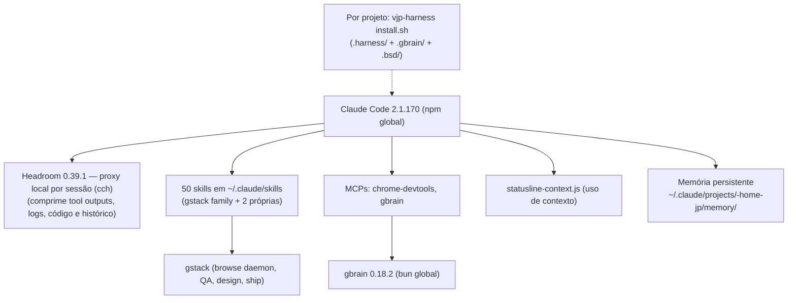

# Harness JP — Replicação de Máquina

> Snapshot de 2026-06-12 da máquina principal (WSL2 / Linux Mint kernel 6.6.87.2-microsoft).
> Objetivo: reproduzir o ambiente Claude Code completo (skills, hooks, MCPs, ferramentas)
> em qualquer PC novo com `bash machine/bootstrap.sh`.
>
> Este diretório cobre o **nível máquina** (`~/.claude` global). O nível **projeto**
> (`.harness/`, `.gbrain/`, `.bsd/`) continua sendo o `install.sh` da raiz deste repo.

---

## 1. Arquitetura do harness



## 2. Inventário completo

### 2.1 Runtimes e ferramentas base

| Item | Versão | Instalação |
|---|---|---|
| Node.js | v24.15.0 | nvm |
| Bun | 1.3.14 | curl installer |
| uv (Python) | presente | curl installer |
| Claude Code | 2.1.170 | `npm i -g @anthropic-ai/claude-code` |
| Headroom | 0.39.1 | `uv tool install --python 3.13 "headroom-ai[proxy,code]==0.39.1"` → `~/.local/bin/headroom`; atalho `cch` e `HEADROOM_BEACON=off` no `~/.bashrc`; porta 8790. Substitui o RTK (aposentado na v1.22.0) |
| gbrain | 0.18.2 | `~/.bun/bin/gbrain` (⚠️ registry do harness pina 0.35.1.0 — ver §5) |

### 2.2 `~/.claude/` — arquivos replicados (em `export/`)

| Arquivo | Papel |
|---|---|
| `CLAUDE.md` | `@HEADROOM.md` + `@HARNESS.md` (importa a referência do Headroom e as Regras Globais do harness) |
| `HEADROOM.md` | Referência de uso do Headroom (`cch`, `headroom savings`, `doctor`, telemetria desligada) |
| `HARNESS.md` | **Regras Globais do harness** — desde a v2.0.0 é **gerado** de `core/` por `template/tools/sync-rules.js` (não edite à mão). O passo 6 do bootstrap roda `sync-rules.js --global`, que regrava `~/.claude/HARNESS.md` |
| `AGENTS.md` | Mesmo bundle (gerado, idêntico ao `HARNESS.md`). Desde a v2.0.0 o global do Codex vai para **`~/.codex/AGENTS.md`** e o do Antigravity para **`~/.gemini/GEMINI.md`** (blocos gerenciados). `~/AGENTS.md` (v1) só é atualizado se já existir e for nosso — ver `docs/MIGRACAO-v2.md` |
| `settings.template.json` | settings completo: modelo `claude-fable-5[1m]`, statusline, plugin vercel, allowedTools, MCPs |
| `statusline-context.js` | Statusline custom: tokens de contexto + percentual (lê transcript) |
| `skills/` | skills leves vendorizadas (a `gstack` NÃO — 1.5 GB com node_modules; reinstala via gstack, ver bootstrap). `skills/projeto-novo/` é **gerada** de `core/protocolo/`. O `sync-rules.js --global` replica as skills reais (não-symlink) também em `~/.agents/skills`, `~/.gemini/config/skills` e `~/.gemini/antigravity-cli/skills` |

### 2.3 Hooks (em `settings.json`)

| Hook | Matcher | Comando | Efeito |
|---|---|---|---|
| PreToolUse | `Write\|Edit` | `bash ~/.local/share/vjp-harness/machine/hooks/harness-guard.sh` | Guard V-JP: confere escrita em `.harness/` |

> 2026-10-04 (v1.22.0): o hook `Bash` → `rtk hook claude` saiu. A compressão agora é do Headroom, no proxy (`cch`), sem hook.

### 2.4 Skills (50)

- **48 da família gstack** (instaladas pelo gstack; preamble-tier no frontmatter): planejamento (`autoplan`, `plan-ceo/design/eng/devex-review`, `office-hours`, `plan-tune`), design (`design-consultation`, `design-shotgun`, `design-html`, `design-review`), QA/validação (`qa`, `qa-only`, `verify`-like `browse`, `benchmark`, `health`, `devex-review`), entrega (`ship`, `land-and-deploy`, `landing-report`, `canary`, `document-release`, `document-generate`, `retro`), segurança (`cso`, `careful`, `freeze`, `guard`, `unfreeze`), browser (`gstack`, `browse`, `connect-chrome`, `scrape`, `skillify`, `setup-browser-cookies`, `open-gstack-browser`, `pair-agent`), memória/contexto (`learn`, `context-save`, `context-restore`, `setup-gbrain`, `sync-gbrain`), outros (`codex`, `investigate`, `review`, `make-pdf`, `setup-deploy`, `gstack-upgrade`, `benchmark-models`, `harness-engineering`).
- **2 próprias (criadas 2026-06-12)**: `fullstack-validate` e `arch-review` — ver §4.
- **1 oficial Anthropic**: `frontend-design` (anti "AI slop" visual; copiada de `anthropics/skills` @ `575462609294`).
- **1 externa self-contained**: `ui-ux-pro-max` (base de design UI/UX pesquisável — 84 estilos, 192 paletas, 74 pares de fontes, etc). NÃO vendorizada nem via plugin marketplace (o registry deste `~/.claude` tem paths Windows e quebraria). Instala/atualiza pelo script `skills/ui-ux-pro-max/reinstall.sh` deste repo (clona `nextlevelbuilder/ui-ux-pro-max-skill` e re-aplica o patch `${CLAUDE_PLUGIN_ROOT}`→absoluto, `python`→`python3`). O `bootstrap.sh` chama esse reinstall no passo 6. Uso obrigatório para tarefas de front — ver `HARNESS.md` §"Frontend — UI/UX Pro Max obrigatória".

### 2.4b Hooks de validação por projeto (templates genéricos — `machine/hooks/`)

Hooks **portáveis, sem referência a projeto nenhum** — NÃO são instalados globalmente.
Aplica-se sob demanda, em qualquer projeto Node/TS:

```bash
bash ~/.local/share/vjp-harness/machine/hooks/install-hooks.sh /caminho/do/projeto
```

| Template | Evento | Comportamento (auto-detecta pnpm/yarn/bun/npm) |
|---|---|---|
| `stop-typecheck.sh` | Stop | Bloqueia o fim do turno (exit 2) se houver `.ts/.tsx` mexido e o typecheck falhar; sai em silêncio em projeto sem TS; anti-loop via `stop_hook_active` |
| `post-lint.sh` | PostToolUse `Edit\|Write` | `eslint --fix` no arquivo tocado, só se o projeto tiver config de ESLint; nunca bloqueia |

O instalador é idempotente e faz merge no `.claude/settings.json` do projeto sem destruir hooks existentes. Para remover: apagar `.claude/hooks/` + entradas no settings do projeto.

### 2.5 MCPs

**Ativos (em `settings.json`, replicados):**

| Servidor | Comando | Uso |
|---|---|---|
| `chrome-devtools` | `npx -y chrome-devtools-mcp@1.10.1` (fixado — R6; atualize com `npm view chrome-devtools-mcp version`) | Validação visual real: screenshot, console, network |
| `gbrain` | `~/.bun/bin/gbrain serve` | Memória/grafo de conhecimento |
| `context7` | `npx -y @upstash/context7-mcp@3.2.0` | Docs atualizadas de libs (menos API alucinada) |

**Stale no `~/.claude.json` global (legado Windows — `cmd /c`, paths `C:/Users/JPDEV`) — NÃO replicar, remover (ver §5):** `playwright`, `postgres` (creds dev do Executor hardcoded), `filesystem`, `memory`, `sequential-thinking`, `brave-search` (API key exposta), `browserbase` (API key exposta), `stitch` (tokens OAuth Google expostos), `obsidian-vault` (vault desinstalado em 2026-06-08).

### 2.6 Plugins

- `vercel@claude-plugins-official` — habilitado em settings.
- `frontend-design@claude-plugins-official` — registro stale apontando para cache Windows; reinstalar no PC novo se quiser (`/plugin`).

### 2.7 O que NÃO se replica por arquivo (refazer no PC novo)

- **Credenciais**: `.credentials.json`, `accounts-vault.json` → login interativo (`claude` → /login).
- **Histórico/estado**: `history.jsonl`, `projects/`, `sessions/`, `shell-snapshots/`, caches.
- **Memória** (`projects/-home-jp/memory/`): copiar manualmente se quiser levar o contexto pessoal (o bootstrap oferece via flag `--with-memory` se o tarball existir).

### 2.8 Stack adjacente (fora do escopo do bootstrap, só referência)

- **CLIProxyAPI** em `:8317` (Claude/Codex/Gemini via assinaturas pessoais).
- **Hermes Agent** (`~/.hermes/config.yaml`) — CLI de IA separado; JP dispara pessoalmente.
- **Proxy OpenAI local `:3099`** referenciado no bloco `env` do settings (`CLAUDE_CODE_USE_OPENAI`) — ver pendência em §5.

---

## 3. Replicação em PC novo

```bash
git clone git@github.com:Joao-Pedro-AI-Visionary/vjp-harness.git
bash vjp-harness/machine/bootstrap.sh
```

O script é idempotente e cobre: nvm+Node 24, Bun, Claude Code, Headroom (pin PyPI via uv),
configs do `export/`, skills, regras globais geradas de `core/` para Claude Code, Codex e
Antigravity (`sync-rules.js --global`), gbrain, e instruções finais (login, gstack, MCP keys,
confiança dos hooks do Codex via `/hooks`).
Passo a passo manual documentado dentro do próprio script.

---

## 4. Fluxo de trabalho — "sempre validado, front e back"

O harness agora cobre o ciclo completo. Regra de ouro: **nenhuma feature é declarada
pronta sem passar pelo gate `/fullstack-validate`**.

| Fase | Skill | Quando |
|---|---|---|
| Ideia | `office-hours` → `plan-ceo-review` | Antes de codar algo novo |
| Plano | `autoplan` (roda os 4 reviews) ou `plan-eng-review` + `plan-design-review` | Plano pronto, antes de implementar |
| Design | `design-consultation` (DESIGN.md) / `design-shotgun` (variantes) | UI nova sem sistema de design |
| Implementação | (normal) + `investigate` para bugs | — |
| **Gate de entrega** | **`fullstack-validate`** — estática, back, DB, visual (chrome-devtools), E2E, fase proativa | **Sempre, ao fim de qualquer feature** |
| Polimento visual | `design-review` (fixa e re-verifica com screenshots) | Mudança visual significativa |
| Arquitetura | **`arch-review`** — filas, load balance, observabilidade, escalabilidade, resiliência | Decisões estruturais ou auditoria periódica |
| Segurança | `cso` (daily ou comprehensive) | Mensal + antes de release grande |
| Entrega | `ship` → `land-and-deploy` → `canary` | Código validado |
| Pós-ship | `document-release`, `retro`, `learn` | Após merge |

As duas skills novas:

- **`fullstack-validate`** — gate em 5 fases com evidência obrigatória (saída de comando, screenshot, SELECT no banco). Inclui checklist visual (hierarquia, espaçamento 4/8, contraste AA, estados hover/focus/loading/empty/erro), validação de contrato (payload inválido → 400 estruturado), `EXPLAIN ANALYZE` em queries novas, teste de auth negativo, e fase proativa de "ligar os pontos" (paginação, fila, índice, log, impacto em outros módulos).
- **`arch-review`** — revisão staff-level em 7 dimensões (dados, filas, escala, resiliência, observabilidade, segurança operacional) com saída priorizada em 3 faixas (agora / próximo ciclo / quando escalar) + "o que NÃO fazer ainda".

---

## 5. Pendências recomendadas (com tradeoff)

1. **🔴 Rotacionar chaves expostas** no `~/.claude.json`: Brave Search, Browserbase (key + project), Stitch (token + refresh token Google). Estão em plaintext num arquivo que já circulou entre máquinas. Custo: 15 min. Tradeoff: nenhum — só fazer.
2. **🔴 Remover os 9 MCPs stale Windows** do `~/.claude.json` (lista em §2.5): pronto para rodar — `bash ~/.local/share/vjp-harness/machine/cleanup-stale-mcps.sh` com o Claude Code **fechado** (faz backup e usa `claude mcp remove --scope user`). Tradeoff: se voltar a usar o PC Windows, reconfigura lá (os configs são por máquina mesmo).
3. **🟡 Bloco `env` do settings** (`CLAUDE_CODE_USE_OPENAI=1` → proxy `:3099` "gqwen/coder-model"): parece experimento antigo. Se o proxy não está mais em uso, remover — risco de comportamento surpresa em update do CC. Tradeoff: se ainda usa o roteamento qwen, manter e documentar aqui qual serviço sobe o `:3099`.
4. **🟡 Drift do gbrain**: instalado 0.18.2, `template/registry.json` pina 0.35.1.0. Alinhar (upgrade do global ou ajuste do pin) e rodar `bsd.js --doctor`. Tradeoff: upgrade pode mudar schema da memória — fazer backup do `.gbrain/` antes.
5. ✅ **`frontend-design`**: resolvido instalando como skill direto de `anthropics/skills` (sem plugin/marketplace) — ver §5b.6.
6. **🟢 Memória → git**: considerar versionar `~/.claude/projects/-home-jp/memory/` num repo privado (ou pasta deste) para a memória pessoal sobreviver a reinstalações. Tradeoff: contém contexto pessoal/clientes — manter privado.

## 5b. Achados da pesquisa online (2026-06-12) — status de aplicação

1. ✅ **RTK 0.39.0 → 0.42.3** (hardening de permissões, fixes de pipe/grep/git): binário global atualizado (musl, checksum verificado), 0.39.0 preservado em `~/.local/bin/rtk-0.39.0.bak`, pin do `template/registry.json` atualizado (`v0.42.3` @ `de78d70aee86`), `rtk gain` e hook validados.
2. ✅ **CVE no Postgres MCP** (`@modelcontextprotocol/server-postgres` — SQL injection 2026, pacote descontinuado): marcado `deprecated` + `securityNote` no registry; novo componente **`supabase-mcp`** (`@supabase/mcp-server-supabase@0.8.2`) adicionado como substituto recomendado. Falta migrar `config/mcp.json` dos projetos que usarem postgres.
3. ✅ **Hooks de validação** (Stop typecheck + PostToolUse eslint): templates **genéricos** em `machine/hooks/` com instalador idempotente — ver §2.4b. Decisão do JP: nada automático/global, nada amarrado a projeto; aplicar sob demanda por projeto.
4. ✅/⏳ **MCPs**: **Context7** adicionado ao settings global (pinado @3.2.0). **Sentry MCP** fica para quando houver projeto com Sentry ativo (remoto OAuth, sem token em disco).
5. ✅ **`fallbackModel`**: `["claude-opus-4-8", "claude-sonnet-4-6"]` no settings global.
6. ✅ **frontend-design oficial** (Anthropic): instalada como skill em `~/.claude/skills/frontend-design` (pinada @ `575462609294`) e vendorizada no export — sem depender do plugin/marketplace.

## 6. Changelog deste pacote

- **2026-06-12** — Pacote criado. Hook rtk duplicado removido do `settings.json`. Skills `fullstack-validate` e `arch-review` criadas e vendorizadas. 48 skills gstack copiadas para `export/skills/`.
- **2026-06-12 (tarde)** — Pesquisa online: §5b adicionado (RTK 0.42.3 disponível, CVE no Postgres MCP pinado no registry, hooks PostToolUse/Stop de validação, Context7/Sentry MCP, fallbackModel).
- **2026-06-12 (aplicação)** — Tudo do §5b aplicado: RTK 0.42.3 instalado + pin atualizado; registry com `supabase-mcp` novo e `postgres-mcp` deprecado; skill `frontend-design` oficial instalada+vendorizada; `fallbackModel` e `context7` no settings; templates de hooks genéricos em `machine/hooks/` (sem referência a projetos — instalação sob demanda via `install-hooks.sh`, validados em teste de ponta a ponta); `cleanup-stale-mcps.sh` criado (rodar com CC fechado); `settings.template.json` regenerado; bootstrap.sh com RTK 0.42.3 musl.
- **2026-08-29 (v1.19.0, correção de path)** — `~/vjp-harness` → `~/.local/share/vjp-harness` em `export/HARNESS.md`, `export/AGENTS.md` e neste arquivo: o diretório antigo **não existe** nesta máquina, então os comandos documentados de `install.sh`, `install-hooks.sh`, `cleanup-stale-mcps.sh` e do reinstall da `ui-ux-pro-max` falhavam. `AGENTS.md` reespelhado com a seção "Portões de qualidade" (tinha ficado defasado). Path Linux `/home/jp/...` na descrição do patch da ui-ux trocado por `$HOME/...` (o script já respeitava `$HOME`).
- **2026-08-29 (v1.19.0)** — Portões de qualidade `test-gate` e `pr-review` adicionados como skills globais em `machine/export/skills/` (o passo 6 do bootstrap já as instala em `~/.claude/skills/`; registradas no `template/registry.json` com `verify.type: "skill"`, então o `--doctor` acusa ausência). Fia o portão **`prova-viva`** no `gates.js`: recibo em `.bsd/prova-viva.json` conferido contra o `HEAD` — verde de outro commit conta como vermelho. Rigor proporcional pelo Dial (`stageMinLevel: test-gate=1, pr-review=2`), sem lei nova. `machine/export/HARNESS.md` ganhou a seção "Portões de qualidade". Spec: `specs/quality-gates-pr-review-test-gate/spec.md`.
- **2026-07-23** — Regras globais viram canônicas no repo: `machine/export/HARNESS.md` (fonte da verdade das Regras Globais, incl. 3 seções novas: Harness como 1ª fonte de verdade, Orquestração fan-out/fan-in + fluxo de 9 passos, UI/UX Pro Max obrigatória) e `machine/export/AGENTS.md` (espelho cross-CLI). `export/CLAUDE.md` passa a importar `@HARNESS.md`. Skill `ui-ux-pro-max` adicionada em `skills/ui-ux-pro-max/reinstall.sh` (portável via `$HOME`). `bootstrap.sh` atualizado: copia `HARNESS.md`, instala `~/AGENTS.md` e chama o reinstall da ui-ux-pro-max (passo 6).
- **2026-10-04 (v1.22.0)** — Compressor de Contexto trocado: RTK → **Headroom 0.39.1**. Sai o hook `PreToolUse` `rtk hook claude` do `settings.template.json` e o `RTK.md`; entra `HEADROOM.md` e o passo 4 do bootstrap instala o Headroom via `uv tool`, grava `HEADROOM_BEACON=off` e o atalho `cch` (`headroom wrap claude --port 8790 --code-memory none`). Proxy por sessão: o `settings.json` global não ganha `ANTHROPIC_BASE_URL`. Spec: `specs/headroom-no-lugar-do-rtk/spec.md`.
- **2026-10-08 (v2.0.0)** — **Fonte única portável.** Regras, guardrails e checklists passam a morar em `core/` (raiz do repo) e são renderizados por `template/tools/sync-rules.js` para Codex (`~/.codex/AGENTS.md`), Claude Code (`~/.claude/HARNESS.md`), Antigravity (`~/.gemini/GEMINI.md`) e para os projetos (`AGENTS.md`, `CLAUDE.md` com `@imports`, `.agents/rules`, `.cursor/rules`). `export/AGENTS.md` e `export/HARNESS.md` viram gerados e idênticos (o espelho manual tinha derrapado). O bootstrap deixa de copiar para `~/AGENTS.md` e roda `sync-rules.js --global` no passo 6. `chrome-devtools-mcp` fixado em 1.10.1 (fim do `@latest`). Skill `projeto-novo` gerada de `core/protocolo/`. Decisões em `core/decisoes/`; migração em `docs/MIGRACAO-v2.md`.
